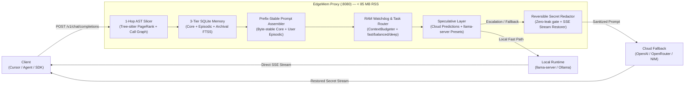

# EdgeMem

[](https://www.python.org/downloads/)
[](https://opensource.org/licenses/MIT)
[](https://github.com/dhanushveerla/edgemem/actions/workflows/ci.yml)
[](https://pypi.org/project/edgemem-proxy/)

> **Local-first LLM memory, AST slicing, RAM-aware routing, and speculative decoding proxy built for 8 GB laptops (Linux, macOS, Windows).**

EdgeMem is a lightweight, zero-bloat OpenAI-compatible `/v1` proxy and Model Context Protocol (MCP) server. It equips local coding models (`llama-server`, Ollama, vLLM) and cloud APIs with tiered architectural memory, 1-hop AST symbol slicing, dynamic context budgeting, and speculative acceleration — maintaining a **steady-state proxy RSS under 85 MB with zero vector databases, zero embedding models, and zero extra LLM calls** on the request hot path.

---

## Quickstart (60 Seconds)

### 1. Installation

```bash
# Run instantly with uvx (no install needed):
uvx edgemem-proxy --help

# Or install via pip / uv:
pip install edgemem-proxy
# or: uv pip install edgemem-proxy
```

<details>
<summary>Source installation from git</summary>

```bash
git clone https://github.com/dhanushveerla/edgemem.git
cd edgemem
uv sync
uv run pytest -q
```
</details>

### 2. Initialize and Start

```bash
# Generate default edgemem.toml in current directory or ~/.config/edgemem/
edgemem init

# Start proxy on http://127.0.0.1:8080 (OpenAI /v1 proxy + Streamable HTTP /mcp server)
edgemem serve
```

### 3. Connect Any Client

**Python (OpenAI SDK):**
```python
from openai import OpenAI

client = OpenAI(base_url="http://127.0.0.1:8080/v1", api_key="sk-local")
response = client.chat.completions.create(
    model="edgemem-local",
    messages=[{"role": "user", "content": "Explain calculate_settlement in ledger/calculator.py"}],
)
print(response.choices[0].message.content)
```

**Cursor / Windsurf / Continue:**
- Override OpenAI Base URL: `http://127.0.0.1:8080/v1`
- API Key: `sk-local` (or any string)
- Model: `edgemem-local` (or your local model name)

---

## Architecture



---

## Verified Hardware Benchmarks

All metrics measured empirically on physical test hardware using `bench/run_bench.py` and committed in `bench/baselines/` and `docs/ROADMAP.md`.

**Test Hardware Platform (Lenovo LOQ `83FQ`):**
- **CPU:** Intel Core i5-12450HX (8 cores / 12 threads)
- **Host RAM:** 7.7 GB usable DDR5
- **Discrete GPU:** Intel Arc A530M (4 GB VRAM)
- **Operating System:** Windows 11 Home 64-bit (build 26100)
- **Model Checkpoint:** `Qwen2.5-Coder-3B Q4_K_M` (GGUF)

### Table 1: Memory Ceiling & Active RAM Reduction (Phase 1.1.2)

Target budget: total system peak RSS `<= 3.0 GB` on 8 GB laptops, keeping `>= 800 MB` free for OS and IDE buffers.

| Configuration | Execution Target | Context Window (`-c`) | Peak System RSS | Host RAM Left Free | EdgeMem Proxy RSS |
|---|---|---|---|---|---|
| Unbudgeted Baseline | CPU (Ollama unconstrained) | 8192 | 4,180.0 MB | ~3.5 GB (breached) | — |
| **T1-Budgeted (Watchdog + Bucketing)** | **2-Thread CPU** | **2048** | **2,129.7 MB** | **846.0 MB OS Free** | **80.4 MB** |
| **T2-Vulkan (Arc A530M Offload)** | **Arc A530M (Vulkan)** | **4096** | **2,174.2 MB** | **1.82 GB VRAM used** | **81.2 MB** |
| **Steady-State Idle (Post-Unload)** | **Background Worker** | — | **Baseline Restored** | **Fully Reclaimed (2.1s)** | **79.7 MB** |

### Table 2: Prefix-Cache Multi-Turn TTFT & AST Slicing (Phase 1.1.3)

Multi-turn latency reduction via byte-stable system prompt ordering and 1-hop AST call-graph extraction.

| Measurement Dimension | Baseline Turn 1 | Cached Turn 2+ | Improvement / Delta | Cache Evidence |
|---|---|---|---|---|
| **T1-CPU Multi-Turn TTFT** | 2,441.0 ms | **800.2 ms** | **3.05x speedup (-67.2%)** | `cache_n` 139 -> 814 tokens |
| **T2-Vulkan Multi-Turn TTFT** | 2,469.5 ms | **773.4 ms** | **3.19x speedup (-68.7%)** | `cache_n` 139 -> 812 tokens (3/3 hits) |
| **1-Hop AST Slicer (`slice_symbol`)** | 240,660 tokens (full repo) | **800 tokens** (symbol slice) | **99.7% token reduction** | **47 ms warm lookup**, 0 false callees |

### Table 3: Zero-RAM Local Speculative Decode (Phase 1.1.4)

Evaluation on `n=3` deterministic code-edit tasks (`temperature=0.0`, `max_tokens=512`) using current `llama-server` `b12631+` preset engine.

| Hardware Target | Preset Engine | Generation Speed | Wall-Clock Time | Wall Reduction | Draft Acceptance | Extra RAM |
|---|---|---|---|---|---|---|
| **T1-CPU (`-c 2048`)** | Baseline (`none`) | 11.64 tok/s | 36,670.2 ms | — | — | 0 MB |
| **T1-CPU (`-c 2048`)** | `ngram-simple` | **35.71 tok/s** | **13,234.0 ms** | **-63.9% (3.07x)** | **84.4%** (1,015 / 1,202) | **0 MB** |
| **T1-CPU (`-c 2048`)** | `ngram-mod` | 34.64 tok/s | 13,295.3 ms | -63.7% (2.98x) | 85.2% (982 / 1,152) | 16 MB |
| **T2-Vulkan (`Arc A530M`)** | Baseline (`none`) | 29.02 tok/s | 15,342.7 ms | — | — | 0 MB |
| **T2-Vulkan (`Arc A530M`)** | `ngram-simple` | **82.52 tok/s** | **6,264.5 ms** | **-59.2% (2.84x)** | **84.3%** (1,001 / 1,188) | **0 MB** |
| **T2-Vulkan (`Arc A530M`)** | `ngram-mod` | 77.30 tok/s | 6,574.7 ms | -57.1% (2.66x) | 85.0% (963 / 1,133) | 16 MB |

*Reproduce via:* `python bench/run_bench.py --tasks-file bench/stress_tasks.json --dry-run` or generate optimized llama.cpp server commands with `edgemem llama-cmd --profile t2-vulkan --preset ngram-simple`.

---

## Core Capabilities

| Capability | Module | Description | Technical Implementation |
|---|---|---|---|
| **Synthetic Memory** | `edgemem.memory` | Tiered memory hierarchy: Core (pinned invariants), Episodic (recency decay), and Archival. | SQLite WAL mode, BM25 FTS5 indexing, salience-decay pruning, async consolidation worker. |
| **RAM Watchdog** | `edgemem.proxy.watchdog` | 3-OS memory watchdog (`normal`, `soft`, `hard`) capping local context before OOM occurs. | Native `/proc/meminfo` (Linux), `sysctl` (macOS), Win32 `GlobalMemoryStatusEx` (Windows). |
| **ContextBudgeter** | `edgemem.proxy.budgeter` | Unified ADR-03 dynamic context window controller. | Bucketed `num_ctx` (`[2048, 4096, 8192]`) with derived prompt escalation threshold. |
| **1-Hop AST Slicing** | `edgemem.slicer` | Focuses code context on a target symbol, its callers, and its imported callees. | Tree-sitter AST parsing, NetworkX call graphs, `mtime`-cached symbols, generic callee pruning. |
| **Task-Tier Routing** | `edgemem.proxy.classifier` | Zero-LLM heuristic classification into `fast`, `balanced`, or `deep`. | Regex syntax diff/traceback checks, context length thresholds (< 0.1 ms latency, 0 LLM calls). |
| **Speculative Decoding** | `edgemem.proxy.speculative` | Accelerates code edits locally and via cloud predicted outputs. | Cloud Predicted Outputs + fail-open circuit breaker; llama.cpp `ngram-simple` / `draft` presets. |
| **Reversible Redactor** | `edgemem.privacy` | Deterministic secret & PII masking gate. | High-entropy regex masking before cloud dispatch; live SSE stream chunk placeholder restoration. |
| **Model Context Protocol** | `edgemem.proxy.mcp_server` | Streamable HTTP MCP server at `/mcp`. | Exposes `edgemem_remember`, `edgemem_recall`, `edgemem_repo_map` (with `focus_symbol`). |

---

## Honest Limitations

EdgeMem is engineered specifically for local execution on resource-constrained devices. By design, it makes deliberate engineering trade-offs:
- **No Dense Vector Databases or Embedding Models:** EdgeMem does not run background embedding models or vector databases. Retrieval relies on exact-match AST symbol graphs and deterministic SQLite FTS5 BM25 search.
- **Zero-LLM Heuristic Classification:** Request task tiers (`fast`, `balanced`, `deep`) are assigned via deterministic lexical heuristics in < 0.1 ms. While fast and zero-cost, heuristics cannot infer semantic intent on ambiguous, unformatted user turns.
- **Speculative Decoding Scope:** The zero-RAM `ngram-simple` preset accelerates repetitive syntax, boilerplate, and code edits (84%+ draft acceptance). For open-ended creative writing or novel greenfield prose, draft acceptance decreases.
- **Cloud Predicted Outputs Availability:** Cloud predicted outputs require a supporting provider endpoint (e.g. OpenAI). When a provider rejects prediction parameters with HTTP 400/422, EdgeMem automatically fails open, strips the prediction payload, and retries the request without failing the user turn.

---

## Configuration & References

<details>
<summary><b>Configuration Reference (edgemem.toml)</b></summary>

```toml
[proxy]
host = "127.0.0.1"
port = 8080
auth_token = "sk-local"
cors_origins = ["*"]

[memory]
enabled = true
db_path = ".edgemem/memory.db"
max_injected_tokens = 500
inject_constraints = true
compact_middle_turns = true
compact_min_turn_tokens = 40
keep_recent_turns = 2
auto_extract = true

[resources]
enabled = true
local_backend = "llama_server" # "llama_server" or "ollama"
ram_threshold_soft_mb = 1024.0
ram_threshold_hard_mb = 512.0
watchdog_poll_s = 2.0
ctx_buckets = [2048, 4096, 8192]
max_local_ctx = 8192
idle_unload_s = 300.0

[speculative]
predicted_outputs_enabled = true
min_prediction_chars = 40
max_prediction_chars = 30000
min_prediction_lines = 3
llama_preset = "ngram-simple"
draft_model_path = ""

[router]
local_base_url = "http://127.0.0.1:8081/v1"
local_model = "Qwen2.5-Coder-3B"
cloud_base_url = "https://api.openai.com/v1"
cloud_model = "gpt-4o"
cloud_api_key_env = "OPENAI_API_KEY"

[privacy]
enabled = true
redact_secrets = true
redact_emails = true
redact_ips = false
```
</details>

<details>
<summary><b>CLI Command Reference</b></summary>

EdgeMem provides a unified command-line interface:

- `edgemem init`: Create an annotated `edgemem.toml` configuration file.
- `edgemem serve [--host HOST] [--port PORT]`: Start the proxy and MCP server.
- `edgemem status`: Inspect proxy status, memory fact counts, watchdog pressure, and cache telemetry.
- `edgemem slice PATH [--symbol SYMBOL] [--tokens TOKENS]`: Generate an AST repository map or 1-hop symbol slice.
- `edgemem llama-cmd --model PATH [--profile t1-cpu|t2-vulkan|t2-gpu] [--preset ngram-simple|ngram-mod|draft]`: Build an optimized `llama-server` execution command.
- `edgemem memory list [--session ID] [--kind constraint|constant|file|note]`: List stored synthetic facts.
- `edgemem memory search QUERY`: Search stored facts using SQLite BM25 FTS5.
- `edgemem memory delete KEY [--session ID]`: Delete or supersede a memory entry.
- `edgemem memory clear [--session ID]`: Clear session or global memory records.
- `edgemem doctor`: Check system environment, Tree-sitter parsers, SQLite FTS5 support, and hardware specs.
</details>

<details>
<summary><b>MCP Client Configuration</b></summary>

Add EdgeMem as an MCP server in your client configuration:

**Claude Desktop (`claude_desktop_config.json`):**
```json
{
  "mcpServers": {
    "edgemem": {
      "command": "uvx",
      "args": ["edgemem-proxy", "serve"]
    }
  }
}
```

**Remote / Streamable HTTP MCP (Cursor, Continue, Claude Code):**
- **Transport:** Streamable HTTP (SSE)
- **URL:** `http://127.0.0.1:8080/mcp`
- **Headers:** `{"Authorization": "Bearer sk-local"}`
</details>

---

## License

EdgeMem is licensed under the [MIT License](LICENSE).
